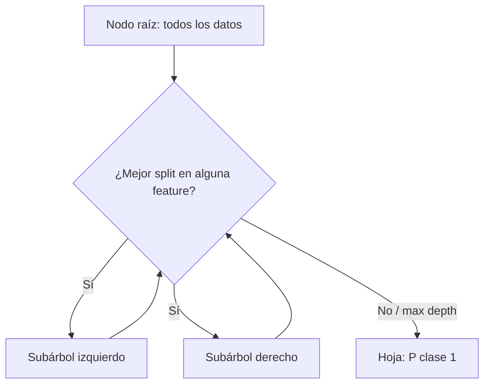
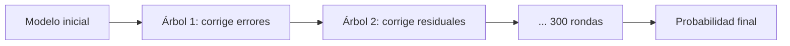

# MindTrack — Insumo detallado para resumen ejecutivo y presentación

> **Propósito de este archivo**  
> Este **no** es el resumen ejecutivo ni las diapositivas finales. Es el **insumo técnico y narrativo**: contexto, decisiones, desarrollo, datos, algoritmos (con énfasis en **cómo se construyen los árboles**), resultados, arquitectura de software y despliegue. A partir de aquí se recorta y redacta lo que irá al informe, al slide deck y a la defensa oral.

**Fuentes cruzadas:** `docs/CONTEXT_MASTER_PROJECT.md` (diseño StudentAI), notebooks Entregables 2–3, `scripts/train_and_export.py`, módulos `src/*`, `app/streamlit_app.py`, artefactos en `models/` y `reports/`, y el historial de desarrollo del producto (Streamlit UX + Cloud) documentado en noviembre de 2026.

---

## Tabla de contenidos (sugerida para armar la presentación)

1. [Identidad y alcance](#1-identidad-y-alcance)  
2. [Línea de tiempo del desarrollo](#2-línea-de-tiempo-del-desarrollo)  
3. [Problema, objetivos y marco ético](#3-problema-objetivos-y-marco-ético)  
4. [Datos: definición, calidad y decisiones de inclusión](#4-datos-definición-calidad-y-decisiones-de-inclusión)  
5. [EDA y hallazgos interpretables](#5-eda-y-hallazgos-interpretables)  
6. [Preprocesamiento (reproducible en código)](#6-preprocesamiento-reproducible-en-código)  
7. [Protocolo experimental: splits, train, validación y test](#7-protocolo-experimental-splits-train-validación-y-test)  
8. [Fundamentos: clasificación binaria con desbalance](#8-fundamentos-clasificación-binaria-con-desbalance)  
9. [Árbol de decisión (un solo árbol): cómo se construye](#9-árbol-de-decisión-un-solo-árbol-cómo-se-construye)  
10. [Random Forest: cómo se construye el bosque](#10-random-forest-cómo-se-construye-el-bosque)  
11. [XGBoost: cómo se construyen los árboles en serie](#11-xgboost-cómo-se-construyen-los-árboles-en-serie)  
12. [Regresión logística (contraste lineal)](#12-regresión-logística-contraste-lineal)  
13. [Pipeline de entrenamiento en el repositorio](#13-pipeline-de-entrenamiento-en-el-repositorio)  
14. [Calibración del umbral (Recall ≥ 0,85)](#14-calibración-del-umbral-recall--085)  
15. [Resultados numéricos y lectura de matrices](#15-resultados-numéricos-y-lectura-de-matrices)  
16. [Por qué XGBoost en producción (frente a RF y LR)](#16-por-qué-xgboost-en-producción-frente-a-rf-y-lr)  
17. [Arquitectura de software MindTrack](#17-arquitectura-de-software-mindtrack)  
18. [Módulo Producción (PRD): flujo de una consulta](#18-módulo-producción-prd-flujo-de-una-consulta)  
19. [Módulo Laboratorio (LAB)](#19-módulo-laboratorio-lab)  
20. [Explicabilidad (SHAP) y motor de recomendaciones](#20-explicabilidad-shap-y-motor-de-recomendaciones)  
21. [Evolución de interfaz y despliegue](#21-evolución-de-interfaz-y-despliegue)  
22. [Reproducibilidad, comandos y entregables](#22-reproducibilidad-comandos-y-entregables)  
23. [Preguntas frecuentes en defensa](#23-preguntas-frecuentes-en-defensa)  
24. [Glosario extendido](#24-glosario-extendido)  
25. [Banco de frases cortas (opcional al redactar slides)](#25-banco-de-frases-cortas-opcional-al-redactar-slides)

---

## 1. Identidad y alcance

| Elemento | Detalle |
|----------|---------|
| **Producto** | **MindTrack** |
| **Nombre en documentación académica** | **StudentAI** — sistema de bienestar y riesgo académico |
| **Curso** | Sistemas Inteligentes |
| **Tipo de solución** | Clasificador binario supervisado + dashboard web |
| **Autores** | Geraldin Pérez · Daniel Hernández |
| **Repositorio GitHub** | https://github.com/Danielhsk/MindTrack |
| **App pública** | https://mindtrack-si.streamlit.app/ |
| **Alcance intencional** | MVP defendible: formulario → predicción → explicación → recomendaciones; **sin** login, **sin** integración institucional, **sin** diagnóstico clínico |
| **Modelo en vivo** | XGBoost (`pipeline_xgboost.joblib`) |
| **Modelos de referencia en UI** | LR y RF en “segunda opinión” y en LAB |

**Mensaje ético (repetir en presentación):** orientación analítica; correlación/predicción **no** implica causalidad; no reemplaza acompañamiento pedagógico ni salud mental profesional.

---

## 2. Línea de tiempo del desarrollo

Narrativa útil para la diapositiva “Metodología / proceso”.

### Fase A — Diseño (CONTEXT_MASTER)

1. Definición del problema: integrar hábitos digitales, sueño, actividad física, bienestar y burnout para estimar `Academic_Failure_Risk`.
2. Alcance MVP: formulario, ML, dashboard, explainability básica (SHAP), reglas, comparación de modelos.
3. Identificación de riesgo de **data leakage** con `Academic_Performance_Score`.
4. Elección de métrica prioritaria: **Recall clase 1** en escenario de alerta temprana.

### Fase B — Entregable 2 (notebook EDA / preprocesamiento)

1. Carga de `academic_risk_dataset.csv` (15.000 × 14).
2. Auditoría de calidad: sin nulos, sin duplicados.
3. Gráficos: distribuciones, boxplots, balance del target, correlación con el objetivo.
4. Codificación: ordinal `Burnout_Level`, one-hot de nominales.
5. Split estratificado 70/15/15.
6. Baseline inicial (regresión logística) para validar que el pipeline aprende señal.

### Fase C — Entregable 3 (notebook comparación)

1. Entrenar LR, Random Forest y XGBoost con la misma matriz X.
2. Obtener probabilidades en validación.
3. Ajustar umbral por modelo para cumplir recall objetivo.
4. Comparar FN/FP, PR-AUC, F1.
5. Evaluar los tres en test; seleccionar producción por `selection_criteria` en metadata.

### Fase D — Producto repositorio MindTrack

1. Estructura `src/`, `app/`, `models/`, `reports/`, `scripts/train_and_export.py` para **reproducir** el experimento sin depender solo de Colab.
2. App Streamlit dual **PRD / LAB**.
3. Exportación de pipelines `joblib` + `metadata.json` para inferencia consistente local y en Cloud.
4. Motor de recomendaciones por reglas (`RULE_THRESHOLDS`).
5. Explicación por contribución (SHAP TreeExplainer en XGBoost).

### Fase E — Productización UX y operación (nov. 2026)

1. UI: barra superior, switch PRD/LAB, formulario en español, estados de carga (`st.status`, toast).
2. Segunda opinión con 3 modelos (informativa).
3. LAB: matrices de confusión interactivas (Plotly), scatter con jitter.
4. Correcciones Cloud (assets Colab, entrypoint `streamlit_app.py` raíz).
5. GitHub Action **Keep Streamlit awake** (Puppeteer) cada 5 h UTC para `mindtrack-si.streamlit.app`.

---

## 3. Problema, objetivos y marco ético

### Pregunta problema (formulación defendible)

¿Es posible construir un sistema basado en Machine Learning que, a partir de variables de hábitos digitales, sueño, actividad física, bienestar y burnout, **estime probabilidad de riesgo académico** y presente el resultado de forma comprensible con factores y recomendaciones?

### Objetivo general

Implementar un prototipo web que ejecute el ciclo completo de un sistema inteligente supervisado sobre datos estudiantiles.

### Objetivos específicos (mapear a evidencias)

| Objetivo | Evidencia en el repo |
|----------|----------------------|
| Analizar datos | Notebook Entregable 2 + sección LAB “Huella de datos” |
| Preprocesar | `src/preprocessing.py`, mismo flujo que notebooks |
| Comparar algoritmos | Entregable 3 + `reports/comparison_validation.csv` |
| Evaluar con métricas adecuadas | Tablas validation/test; gráficos `reports/figures/` |
| Prototipo web | `app/streamlit_app.py` en local y Cloud |

---

## 4. Datos: definición, calidad y decisiones de inclusión

### Archivo

- `data/academic_risk_dataset.csv`
- **15.000 filas**, **14 columnas**

### Listado exhaustivo de columnas

```text
Student_ID
Age
Gender
Education_Level
Daily_Social_Media_Hours
Daily_AI_Tool_Usage_Hours
Sleep_Hours
Physical_Activity_Hours
Mental_Health_Score
Physical_Health_Score
Social_Isolation_Score
Burnout_Level
Academic_Performance_Score
Academic_Failure_Risk
```

### Target

- `Academic_Failure_Risk`: **0** = sin riesgo, **1** = en riesgo (según criterio del dataset).
- Prevalencia clase 1: **~6 %** (≈ 900 estudiantes en riesgo en el corpus completo).

### Decisiones de exclusión (críticas para la defensa)

| Variable | Decisión | Razón explícita |
|----------|----------|-----------------|
| `Student_ID` | **No usar** | Identificador; no aporta patrón generalizable |
| `Academic_Performance_Score` | **No usar en producción** (Experimento B) | Riesgo alto de **data leakage**: el objetivo puede derivarse del desempeño académico; usarlo haría la predicción poco realista en escenario **preventivo** (“¿qué pasa antes de conocer la nota?”) |
| Resto de variables hábitos/bienestar | **Sí usar** | Coherente con narrativa del proyecto |

En el CONTEXT_MASTER se documentó **Experimento A** (con nota) vs **Experimento B** (sin nota). **MindTrack implementa Experimento B** en el formulario y en `LEAKAGE_COLS` (`src/config.py`).

### Calidad

- **0 %** faltantes  
- **0 %** duplicados  
- Outliers **mantenidos**: los árboles (RF, XGBoost) toleran no linealidades y puntos extremos; eliminar outliers podría borrar perfiles de alto riesgo realistas.

---

## 5. EDA y hallazgos interpretables

*(Sintesis para presentación; detalle visual en notebook e imágenes Colab/LAB.)*

### Qué se muestra en el EDA

1. **Balance del target:** fuerte desbalance (clase minoritaria en riesgo) → justifica recall, PR-AUC, pesos de clase.
2. **Distribuciones** de horas de sueño, redes, IA, actividad física.
3. **Boxplots** por grupos (género, educación, burnout) — variabilidad y posibles interacciones que un árbol puede capturar.
4. **Correlaciones** con `Academic_Failure_Risk`: variables de bienestar, aislamiento y burnout suelen alinearse con mayor riesgo (signo y magnitud dependen del feature; ver heatmap en LAB/Colab).
5. **Burnout ordinal:** riesgo tendencialmente mayor en niveles High/Severe (análisis por niveles en `fig_burnout_risk` del LAB).

### Implicación para el modelado

- No basta con accuracy.  
- Convienen modelos que manejen **no linealidad** e **interacciones** (árboles).  
- Calibrar **umbral** separado del 0,5 porque las probabilidades no están balanceadas.

---

## 6. Preprocesamiento (reproducible en código)

Implementación: `src/preprocessing.py` — debe coincidir con notebooks para que Colab, script y app den la misma matriz.

### Paso 1 — Eliminar ID y leakage

```python
drop: Student_ID, Academic_Performance_Score
```

### Paso 2 — Ordinal `Burnout_Level`

Mapeo fijo (`BURNOUT_MAP`):

| Nivel | Código entero |
|-------|---------------|
| Low | 0 |
| Moderate | 1 |
| High | 2 |
| Severe | 3 |

Se usa entero (no one-hot) porque hay **orden** semántico creciente.

### Paso 3 — One-hot nominales

- `Gender`: Male, Female, Non-binary → dummies con `drop_first=True` (categoría de referencia implícita).
- `Education_Level`: High School, College, University → igual.

### Paso 4 — Separar X e y

- `y = Academic_Failure_Risk` como entero 0/1.  
- `X`: 13 columnas tras encoding (ver `metadata.json` → `feature_names`).

### Paso 5 — Inferencia (formulario PRD)

1. Fila única desde diccionario del formulario (`transform_form_row`).  
2. Mismos pasos de encode.  
3. `align_features`: si falta una dummy, se rellena **0** (consistente con `drop_first` en entrenamiento).

**Punto para slides:** el estudiante nunca ve “columnas dummy”; el software transforma Gender/Education internamente.

---

## 7. Protocolo experimental: splits, train, validación y test

### Cómo se parte el dataset (`stratified_split`)

1. Primero: **70 % train**, **30 % temporal** (estratificado por y).  
2. Del temporal: **50 % validation**, **50 % test** → cada uno **15 %** del total.

**Tamaños aproximados (15.000 filas):**

| Conjunto | Filas aprox. | % | Uso |
|----------|-------------|---|-----|
| Train | 10.500 | 70 % | Ajustar parámetros de LR/RF/XGBoost |
| Validation | 2.250 | 15 % | Elegir **umbral**, comparar modelos, métricas reportadas en LAB |
| Test | 2.250 | 15 % | Evaluación **LR, RF y XGB** (τ de validation, sin re-tuning) |

`random_state = 42` en todos los splits (reproducibilidad).

### Qué **no** se hace (deliberado)

- No reentrenar en Streamlit Cloud al abrir la app.  
- No usar test para elegir umbral (evitar optimismo en métricas).

---

## 8. Fundamentos: clasificación binaria con desbalance

### Qué predice el sistema

Para cada estudiante, el modelo estima:

\[
P(y=1 \mid \mathbf{x}) \in [0,1]
\]

Luego se compara con umbral \( \tau \):

- Si \(P \geq \tau\) → alerta / clase 1  
- Si \(P < \tau\) → sin alerta / clase 0  

### Métricas (definiciones para la audiencia)

| Métrica | Fórmula intuitiva | Por qué importa aquí |
|---------|------------------|----------------------|
| **Recall (C1)** | TP / (TP + FN) | “De los que sí están en riesgo, ¿cuántos detectamos?” |
| **Precision (C1)** | TP / (TP + FP) | “De los que alertamos, ¿cuántos son riesgo real?” |
| **F1 (C1)** | media armónica P y R | Balance local entre ambas |
| **PR-AUC** | área bajo curva Precision-Recall | Robusta con **clase rara** |
| **ROC-AUC** | área bajo TPR vs FPR | Puede verse “muy alta” con desbalance; complementar con PR |

### Matriz de confusión (convención sklearn en MindTrack)

Filas = **valor real**, columnas = **predicción**:

|  | Pred 0 | Pred 1 |
|--|--------|--------|
| **Real 0** | TN | FP |
| **Real 1** | FN | TP |

- **FN:** error grave en un sistema de alerta temprana (no detectar riesgo).  
- **FP:** costo de molestia / sobre-alerta.

---

## 9. Árbol de decisión (un solo árbol): cómo se construye

Tanto **Random Forest** como **XGBoost** usan árboles de decisión como bloques. Conviene explicar **un árbol** antes del bosque o del boosting.

### Idea

Un árbol particiona el espacio de features con reglas del tipo:

> Si `Sleep_Hours` ≤ 6,2 → ir a subárbol izquierdo; si no → derecho.

En cada hoja se asigna una probabilidad de clase (proporción de positivos en esa hoja).

### Algoritmo típico (CART, usado en sklearn y XGBoost con variantes)

**Entrada:** conjunto de entrenamiento con features \(\mathbf{x}\) y etiquetas binarias.

**Procedimiento recursivo en cada nodo:**

1. Si criterio de parada → crear **hoja** (predicción = tasa de clase 1 en el nodo).  
2. Si no, para **cada feature** y **cada umbral candidato** (puntos entre valores ordenados):  
   - Dividir datos en izquierda / derecha.  
   - Medir **reducción de impureza** (o ganancia).  
3. Elegir el split que **maximiza la ganancia**.  
4. Repetir en hijos hasta `max_depth` o nodos muy pequeños.

### Impureza Gini (clasificación binaria)

En un nodo con fracciones \(p_0, p_1\) de clases:

\[
Gini = 1 - p_0^2 - p_1^2
\]

Tras un split, se pondera Gini de hijos. El árbol prefiere cortes que **separan** positivos y negativos.

### Criterios de parada en MindTrack (hiperparámetros efectivos)

- **XGBoost:** `max_depth=5` limita profundidad de cada árbol del ensemble.  
- **Random Forest:** `min_samples_leaf=2` evita hojas con un solo registro (menos sobreajuste).

### Ejemplo narrado (sin cifras reales del dataset)

1. Nodo raíz mezcla muchos negativos y pocos positivos.  
2. Mejor split podría ser `Burnout_Level` ≥ 2 o `Sleep_Hours` bajo.  
3. Hoja izquierda: casi solo clase 0. Hoja derecha: mayor proporción de clase 1.  
4. La predicción final del árbol es la frecuencia de clase 1 en la hoja alcanzada.

### Limitación de un solo árbol

Sensible a pequeños cambios de datos (alta varianza). Por eso en el proyecto se usan **ensembles**.



---

## 10. Random Forest: cómo se construye el bosque

### Idea (bagging + árboles decorrelacionados)

En lugar de un árbol, entrena **300 árboles** (`n_estimators=300`) sobre muestras ligeramente distintas y promedia sus votos.

### Pasos de construcción (por cada árbol \(b = 1 \ldots 300\))

1. **Bootstrap:** muestra aleatoria **con reemplazo** de ~10.500 filas de train (tamaño similar al original).  
2. Entrena un árbol de decisión en esa muestra:  
   - En **cada split**, considera un **subconjunto aleatorio** de features (default sklearn: \(\sqrt{n_{features}}\)).  
   - Usa Gini, `min_samples_leaf=2`.  
3. `class_weight='balanced_subsample'` ajusta pesos según frecuencia de clases **en esa bolsa** (ayuda con 6 % positivos).  
4. El árbol puede crecer hasta que las hojas sean puras o mínimas — sin podar fuertemente (RF típico).

### Predicción

Para un estudiante \(\mathbf{x}\):

\[
\hat{p}_{RF}(\mathbf{x}) = \frac{1}{300}\sum_{b=1}^{300} \hat{p}^{(b)}(\mathbf{x})
\]

Es el promedio de probabilidades (o fracción de árboles que votan clase 1).

### Por qué RF funciona bien en MindTrack

- Captura interacciones (ej. alto uso de redes **y** bajo sueño) sin escribirlas a mano.  
- Robusto a escala de features numéricas (sin necesidad de StandardScaler en el pipeline RF).  
- En validation obtuvo **el recall más alto** y **menos FN**, pero también **más FP**.

### Costo computacional

300 árboles × profundidad → más pesado que LR; aceptable offline. En inferencia, la app carga el pipeline completo en segunda opinión.

---

## 11. XGBoost: cómo se construyen los árboles en serie

### Contraste conceptual con Random Forest

| Aspecto | Random Forest | XGBoost |
|---------|---------------|---------|
| Construcción | **Paralela** (árboles independientes) | **Secuencial** (cada árbol corrige errores) |
| Objetivo de cada árbol | Ajustar muestra bootstrap | Ajustar **residuales** del error actual |
| Predicción final | Promedio de árboles | **Suma ponderada** de contribuciones + bias |

### Gradient boosting (intuición)

1. Comenzar con predicción simple (log-odds constantes).  
2. Calcular gradiente de la **pérdida logística** respecto a predicciones malas en observaciones en riesgo no capturadas.  
3. Entrenar un **árbol pequeño** (`max_depth=5`) que apunte a corregir ese gradiente (pseudo-residuales).  
4. Agregar el árbol al modelo con peso `learning_rate=0.05` (aprende lento → menos sobreajuste).  
5. Repetir **300 rondas** (`n_estimators=300`).

### Hiperparámetros MindTrack (y qué controlan)

```text
XGBClassifier(
  n_estimators=300,      # número de árboles boosting
  max_depth=5,           # complejidad de cada árbol
  learning_rate=0.05,    # contribución de cada árbol nuevo
  subsample=0.9,         # filas usadas en cada árbol (estocasticidad)
  colsample_bytree=0.9,  # fracción de features por árbol
  scale_pos_weight=...,  # peso extra clase 1 ≈ n_neg/n_pos en train
  eval_metric="logloss",
  random_state=42,
)
```

`scale_pos_weight` penaliza más los errores en la clase minoritaria (similar espíritu a `class_weight` en otros modelos).

### Árbol por árbol en boosting (narración para defensa)

- **Árbol 1:** captura efectos gruesos (p. ej. burnout alto).  
- **Árbol 2:** corrige estudiantes mal clasificados tras el primero.  
- **Árbol 3…300:** refina fronteras; con `learning_rate` bajo, cada paso es pequeño.

### Predicción final

Suma de scores en hojas de todos los árboles → función logística → **probabilidad** \(P(y=1)\).

### Por qué producción usa XGBoost

- Cumple recall en validation con buen **PR-AUC** y **F1**.  
- En **test** mantiene recall ~**0,88** y PR-AUC ~**0,93** con umbral fijado en validation (buena señal de generalización).  
- Estándar fuerte en tablas heterogéneas; alinea con el diseño original del proyecto.



---

## 12. Regresión logística (contraste lineal)

### Pipeline

`StandardScaler` + `LogisticRegression(class_weight='balanced', max_iter=1000)`.

### Idea

Modela log-odds como **combinación lineal** de features (tras escalar):

\[
\log\frac{p}{1-p} = \beta_0 + \sum_j \beta_j x_j
\]

### Rol en MindTrack

- **Baseline interpretable** (signo de coeficientes).  
- Participa en **segunda opinión**.  
- En validation necesitó umbral **muy alto** (~0,90) para cumplir recall → decision boundary estricta en probabilidad.

### Limitación pedagógica

No modela interacciones complejas sin features manuales; RF/XGBoost las aprenden solas.

---

## 13. Pipeline de entrenamiento en el repositorio

Archivo canónico: `scripts/train_and_export.py` (misma lógica que notebook Entregable 3).

### Bucle por modelo

```text
PARA CADA modelo EN {LR, RF, XGBoost}:
  1. Construir Pipeline sklearn (+ scaler solo en LR)
  2. fit(X_train, y_train)
  3. proba_val = predict_proba(X_val)[:, 1]
  4. tau = find_threshold(y_val, proba_val, recall_target=0.85)
  5. Calcular métricas y TN,FP,FN,TP
  6. joblib.dump → models/pipeline_<key>.joblib
FIN PARA
```

### Salidas además de modelos

- `reports/comparison_validation.csv`  
- `reports/comparison_test.csv`
- `reports/evaluation_test_production.csv`  
- `reports/figures/*.png` (barras, FN/FP, PR, heatmap, matrices estáticas)  
- `models/metadata.json` (umbrales, métricas, lista de features, timestamp UTC)

---

## 14. Calibración del umbral (Recall ≥ 0,85)

**Función:** `find_threshold` en `train_and_export.py`.

### Algoritmo (explícito)

1. Calcular curva precision–recall variando el umbral en validation.  
2. Filtrar puntos donde `recall >= 0.85`.  
3. Entre esos, elegir el umbral que **maximiza F1**.  
4. Si ningún punto cumple recall, usar el umbral mínimo disponible (fallback).

### Umbrales resultantes (corrida en repo)

| Modelo | Umbral τ |
|--------|----------|
| Logistic Regression | ~0,904 |
| Random Forest | ~0,418 |
| XGBoost | ~0,728 |

**Interpretación:** RF es más “sensible” (alerta con probabilidades menores); LR exige probabilidad casi máxima para alertar manteniendo recall.

### Bandas BAJO / MODERADO / ALTO (UI)

Relativas al τ oficial (`probability_to_band` en `predict.py`):

- **ALTO:** \(p \geq \tau\)  
- **MODERADO:** \(\tau/2 \leq p < \tau\)  
- **BAJO:** \(p < \tau/2\)  

La **clase binaria** oficial usa solo τ; las bandas son lectura humana.

---

## 15. Resultados numéricos y lectura de matrices

### Validation (2.250 estudiantes, umbral por modelo)

| Modelo | Recall | Precisión | F1 | PR-AUC | ROC-AUC | FN | FP | TP | TN |
|--------|-------:|----------:|---:|-------:|--------:|---:|---:|---:|---:|
| LR | 0,852 | 0,788 | 0,819 | 0,917 | 0,993 | 20 | 31 | 115 | 2084 |
| RF | **0,874** | 0,715 | 0,787 | 0,899 | 0,992 | **17** | **47** | 118 | 2068 |
| XGB | 0,859 | 0,730 | 0,789 | 0,915 | 0,993 | 19 | 43 | 116 | 2072 |

Comprobación filas: TN+FP+FN+TP = 2250.

Aproximadamente **135** positivos reales en validation (TP+FN ≈ 115+20 = 135).

### Test — los tres modelos (τ de validación, sin re-ajuste · `reports/comparison_test.csv`)

| Modelo | Recall | F1 | PR-AUC | FN | FP |
|--------|-------:|---:|-------:|---:|---:|
| LR | 0,852 | 0,801 | 0,918 | 20 | 37 |
| RF | 0,911 | 0,809 | 0,926 | 12 | 46 |
| **XGB** | **0,881** | **0,824** | **0,933** | **16** | **35** |

**Lectura:** LR gana en validación (F1, menos FP); en test **XGBoost** gana F1 y PR-AUC entre quienes cumplen recall ≥ 0,85 (criterio documentado en `metadata.json` → `selection_criteria`).

### Matrices en LAB (Plotly)

- Color **semántico:** TN y TP navy (aciertos); FP y FN gris (errores) — **no** escala por magnitud (evita que solo TN se vea oscuro porque ~2000 vs ~115).  
- Celdas: abreviatura + conteo; hover con descripción completa.

---

## 16. Por qué XGBoost en producción (frente a RF y LR)

**Criterio explícito (test):** entre modelos con recall ≥ 0,85 → **F1 → PR-AUC → precisión → menos FP → menos FN** (`scripts/train_and_export.py`).

| Partición | Quién lidera | Producción |
|-----------|--------------|------------|
| Validation | LR (F1, menos FP) | Solo calibración de umbral |
| Test | XGB (F1 y PR-AUC) | **Motor en vivo** |

Argumentos **técnicos en test:**

1. Los tres cumplen recall ≥ 0,85.  
2. XGBoost: **F1 0,824** y **PR-AUC 0,933** (mejor en esa jerarquía).  
3. Menos FN que LR (16 vs 20); menos FP que RF (35 vs 46).

**Nota honesta para comité:** si solo importara FN, RF en test (FN=12) compite; si solo importaran alertas falsas en validation, LR destaca — la elección oficial usa la tabla de **test** para generalización.

---

## 17. Arquitectura de software MindTrack

### Capas

```text
┌─────────────────────────────────────────┐
│  app/streamlit_app.py (UI PRD + LAB)    │
├─────────────────────────────────────────┤
│  src/predict.py      → inferencia       │
│  src/preprocessing.py                    │
│  src/explainability.py → SHAP            │
│  src/recommendations.py → reglas         │
│  src/conclusion.py    → texto           │
│  src/lab_viz.py       → Plotly LAB      │
│  src/ui_components.py / ui_theme.py     │
├─────────────────────────────────────────┤
│  models/*.joblib + metadata.json        │
│  data/academic_risk_dataset.csv         │
│  reports/* (métricas y PNG)             │
└─────────────────────────────────────────┘
```

### Entrypoint Cloud

`streamlit_app.py` en raíz importa y ejecuta `app/streamlit_app.py` (patrón Community Cloud).

### Separación PRD vs LAB

| Módulo | ¿Reentrena? | ¿Llama ML en vivo? |
|--------|-------------|---------------------|
| PRD | No | Sí (XGBoost + panel 3 modelos al consultar) |
| LAB | No | Carga CSV/JSON/PNG precomputados + EDA sobre dataset |

---

## 18. Módulo Producción (PRD): flujo de una consulta

Orden real (`render_prd` en `app/streamlit_app.py`):

1. Usuario completa formulario (español) o carga perfil ejemplo (neutral / alerta).  
2. `predict_student(form)` → XGBoost, τ de `metadata.json`.  
3. `panel_opinions(form)` → LR, RF, XGB con sus τ; cuenta acuerdo.  
4. `top_contributions` → SHAP TreeExplainer (top 8).  
5. `generate_recommendations` → reglas por umbrales EDA.  
6. `build_conclusion` → párrafo con disclaimer.  
7. UI: bloque **Estado** (binario), métricas banda/umbral/clase/modelo, gráfico de contribuciones, tarjetas de recomendación.

### Campos del formulario (sin nota académica)

Edad, género, educación, horas redes, horas IA, sueño, actividad física, scores mental/físico, aislamiento, burnout.

---

## 19. Módulo Laboratorio (LAB)

Secciones (`LAB_SECTIONS`):

1. **Panorama** — KPIs: tamaño dataset, % riesgo, métricas XGB val/test.  
2. **Huella de datos** — balance, burnout vs riesgo, correlaciones, scatter con jitter; galería Colab.  
3. **Trazabilidad ML** — split, recall target, exclusiones, timestamp metadata.  
4. **Arena de modelos** — tabla comparativa, **3 matrices confusión**, selector de métrica, FN vs FP, radar.

Propósito pedagógico: demostrar **cómo se llegó** al modelo de producción, no solo la predicción.

---

## 20. Explicabilidad (SHAP) y motor de recomendaciones

### SHAP (modelo de árboles)

`TreeExplainer` asigna a cada feature una contribución **local** que suma (aprox.) a la diferencia respecto al valor base de la predicción.

- Positivo SHAP en clase 1 → empuja hacia alerta.  
- Negativo → empuja hacia no riesgo.

**Limitación para slides:** explica **esta** consulta, no “la verdad causal” del mundo.

### Fallback

Si SHAP falla: importancia global × |valor feature| o coeficientes LR.

### Recomendaciones (`RULE_THRESHOLDS`)

Reglas ejemplo:

- Sueño &lt; 6 h  
- Redes &gt; 6,5 h/día  
- Actividad física muy baja  
- Salud mental &lt; 65  
- Aislamiento alto  
- Burnout High/Severe  

Priorizadas 1–5; textos en español; **no** LLM.

---

## 21. Evolución de interfaz y despliegue

### UX

- De sidebar lateral a **header** con interruptor PRD/LAB.  
- Formulario con profundidad visual (cards, navy institucional).  
- Copy: “Estado” vs probabilidad “Señal”.  
- Feedback de carga con `st.status` y toast.

### Cloud

- Artefactos versionados en Git; deploy en Streamlit Community.  
- `importlib.reload(lab_viz)` + `fileWatcherType=poll` por desarrollo en OneDrive.

### Keep-alive

Workflow `Keep Streamlit app awake`: Puppeteer abre URL pública y pulsa despertar si la app durmió; **cron cada 5 h UTC**.

---

## 22. Reproducibilidad, comandos y entregables

```bash
pip install -r requirements.txt
python scripts/train_and_export.py    # regenera models/ + reports/
python scripts/verify_app_imports.py  # smoke test
streamlit run app/streamlit_app.py
```

| Entregable académico | Archivo |
|---------------------|---------|
| EDA | `notebooks/MindTrack_EDA_Preprocesamiento.ipynb` |
| Comparación modelos | `notebooks/MindTrack_03_Comparacion_Modelos.ipynb` |
| App | Streamlit PRD+LAB |
| Especificación | `docs/CONTEXT_MASTER_PROJECT.md` |
| **Este insumo** | `docs/CONTEXTO_CHAT_Y_PRESENTACION.md` |

---

## 23. Preguntas frecuentes en defensa

**¿Por qué quitar la nota académica?**  
Porque en producción queremos simular alerta **antes** del fracaso observable; incluirla puede inflar métricas (leakage).

**¿Por qué no usar solo accuracy?**  
Con 94 % clase 0, un modelo que siempre predice 0 tendría ~94 % accuracy y **0 % recall**.

**¿RF o XGBoost?**  
RF gana FN; XGBoost gana equilibrio y test. Decisión documentada + segunda opinión en UI.

**¿El modelo “sabe” por qué un estudiante falla?**  
Detecta asociaciones estadísticas en datos históricos; no establece causalidad.

**¿Se puede desplegar sin internet?**  
Sí localmente con `joblib` y CSV; Cloud requiere red.

**¿Cómo actualizar modelos?**  
Reentrenar con script, commit de `models/` y `reports/`, redeploy Streamlit.

---

## 24. Glosario extendido

| Término | Definición |
|---------|------------|
| Boosting | Entrenar modelos débiles en secuencia corrigiendo errores |
| Bagging / Bootstrap | Remuestrear filas con reemplazo para diversificar árboles |
| Gini impurity | Medida de mezcla de clases en un nodo de árbol |
| Hoja | Nodo terminal con predicción |
| Split | Regla de división feature + umbral |
| Umbral τ | Corte de probabilidad para alerta |
| Pipeline sklearn | Encadena preprocessor + modelo en un solo objeto serializable |
| joblib | Formato de persistencia de pipelines |
| PR-AUC | Área bajo curva precision-recall |
| Data leakage | Información del futuro/objetivo filtrándose a features |
| Segunda opinión | Tres modelos consultados; no vincula decisión oficial |

---

## 25. Banco de frases cortas (opcional al redactar slides)

- “15 mil perfiles, 6 % en riesgo: un problema de alerta, no de exactitud global.”  
- “Tres familias de modelos: línea (LR), bosque paralelo (RF), árboles en serie (XGBoost).”  
- “Cada árbol pregunta sí/no sobre features hasta una hoja con probabilidad.”  
- “El bosque promedia 300 árboles; XGBoost suma 300 correcciones con aprendizaje lento.”  
- “Calibramos el umbral en validación para no olvidar estudiantes en riesgo.”  
- “Producción: ganador en test (XGBoost). Laboratorio: validation + test + Docker opcional.”  
- “SHAP muestra qué empujó esta consulta; las reglas traducen hábitos a consejos.”

---

*Documento de insumo — expandir o recortir según tiempo de presentación. Actualizar cifras si se reentrena con `train_and_export.py`.*