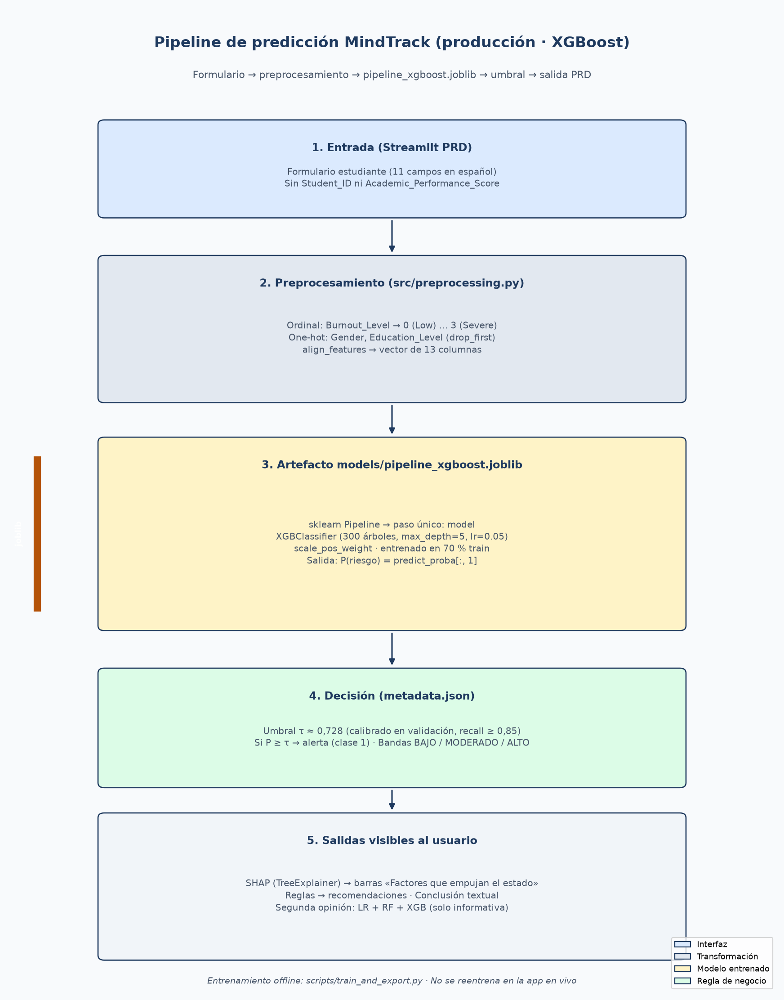

# Explicación del pipeline de producción (MindTrack · XGBoost)

> El motor actual es **XGBoost** (`models/metadata.json` → `production_model_key`). La comparación LR/RF/XGB en test está en `reports/comparison_test.csv`.

## Figura



Regenerar: `python scripts/generate_pipeline_diagram.py`

## Resumen en cinco pasos

1. **Entrada:** el usuario completa el formulario PRD (hábitos, bienestar, burnout). No se pide nota académica.
2. **Preprocesamiento:** misma lógica que en el entrenamiento (`src/preprocessing.py`): burnout ordinal, dummies de género/educación, 13 features alineadas.
3. **Modelo:** `joblib` carga `pipeline_xgboost.joblib` → un `XGBClassifier` con 300 árboles entrenados en el 70 % train.
4. **Umbral:** `metadata.json` fija τ ≈ 0,728 (validación). Se compara la probabilidad con τ para la alerta y las bandas de riesgo.
5. **Explicación:** SHAP sobre el mismo XGBoost, recomendaciones por reglas y conclusión.

## Qué contiene el archivo `.joblib`

No es “código Python” legible: es el **modelo serializado**. En memoria es un `Pipeline` sklearn con un solo paso:

```text
Pipeline(steps=[('model', XGBClassifier(...))])
```

A diferencia de la regresión logística, **no** incluye `StandardScaler`.

## Dónde se usa en código

| Paso | Archivo |
|------|---------|
| Carga del pipeline | `src/predict.py` → `load_production_pipeline()` |
| Preprocesamiento | `src/preprocessing.py` → `transform_form_row()` |
| Umbral y features | `models/metadata.json` |
| SHAP | `src/explainability.py` → `top_contributions()` |
| UI | `app/streamlit_app.py` → `render_prd()` |